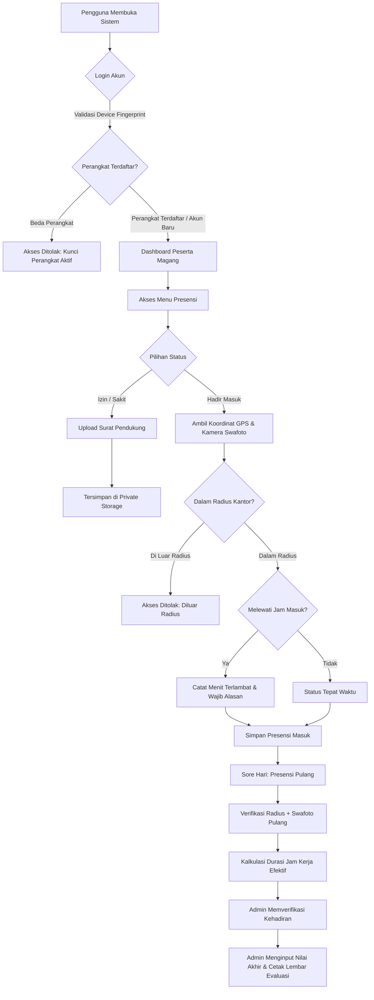

# Presensi Magang (Internship Attendance & Evaluation System)

> Sistem Informasi Manajemen Presensi, Geofencing, dan Evaluasi Akhir Mahasiswa/Siswa Magang Berbasis Web.

[](https://laravel.com)
[](https://php.net)
[](https://tailwindcss.com)
[](https://alpinejs.dev)
[](https://leafletjs.com)
[](https://mysql.com)
[](https://pestphp.com)
[](LICENSE)

---

## Daftar Isi

- [Tentang Aplikasi](#tentang-aplikasi)
- [Modul & Fitur Utama](#modul--fitur-utama)
- [Alur Kerja Sistem](#alur-kerja-sistem)
- [Matriks Hak Akses](#matriks-hak-akses)
- [Struktur Proyek](#struktur-proyek)
- [Panduan Instalasi](#panduan-instalasi)
- [Pengujian Otomatis](#pengujian-otomatis)
- [Standar Keamanan](#standar-keamanan)
- [Lisensi](#lisensi)

---

## Tentang Aplikasi

**Presensi Magang** adalah platform web terintegrasi yang dirancang untuk mengelola absensi, rekapitulasi kehadiran, serta evaluasi akhir peserta magang (*internship*) secara akurat dan objektif.

Sistem ini bersifat universal dan siap diterapkan pada berbagai instansi, perusahaan, lembaga pemerintah, startup, maupun institusi pendidikan. Dilengkapi mekanisme keamanan mutakhir untuk mencegah manipulasi kehadiran (*anti-fraud*), seperti **Device Binding (Anti Titip Absen)**, **Validasi Radius GPS (Geofencing)**, **Verifikasi Kamera Swafoto**, dan **Penyimpanan Berkas Privat**.

---

## Modul & Fitur Utama

### 1. Keamanan & Anti-Kecurangan (Anti-Fraud Engine)
- **Device Binding (Kunci Perangkat)**  
  Akun peserta secara otomatis terikat pada 1 perangkat fisik melalui *device fingerprinting* (UUID browser dan User-Agent). Percobaan login dari perangkat lain akan diblokir otomatis kecuali telah di-reset oleh Administrator.
- **Geofencing GPS Server-Side (Haversine Formula)**  
  Validasi radius presensi dihitung langsung di backend menggunakan rumus Haversine. Peserta tidak dapat melakukan presensi jika berada di luar batas toleransi jarak kantor yang ditentukan.
- **Mandatori Kamera Swafoto (Live Camera)**  
  Wajib menyertakan foto wajah langsung pada saat melakukan presensi masuk dan presensi pulang.
- **Penyimpanan Surat Izin Privat (Private Storage)**  
  Surat sakit dokter dan berkas dispensasi disimpan pada direktori privat (`storage/app/private`). Akses berkas dilindungi otorisasi: hanya Administrator dan peserta pemilik berkas yang diizinkan mengunduh atau melihat dokumen.

### 2. Presensi Harian & Jam Kerja Efektif
- **Presensi Pulang (Check-Out)**  
  Mencatat jam kepulangan dengan validasi geolokasi dan swafoto. Sistem secara otomatis menghitung total durasi jam kerja nyata harian (jam dan menit).
- **Deteksi Keterlambatan Otomatis**  
  Waktu check-in dibandingkan dengan konfigurasi jam masuk kantor (contoh: `07:30`). Jika terlambat, sistem mencatat durasi keterlambatan dalam menit dan mewajibkan pengisian alasan keterlambatan.
- **Pengenalan Hari Libur & Akhir Pekan**  
  Mendukung pengelolaan hari libur nasional dan menonaktifkan status alpa pada hari Sabtu, Minggu, atau tanggal merah yang terdaftar.

### 3. Evaluasi Akhir & Lembar Penilaian
- **5 Rubrik Penilaian Terbobot**:
  | Kriteria Penilaian | Bobot | Deskripsi Indikator |
  |---|:---:|---|
  | **Kedisiplinan & Ketepatan Waktu** | 25% | Kepatuhan jam kerja, presensi harian, dan tata tertib. |
  | **Tanggung Jawab & Integritas** | 25% | Komitmen dalam menyelesaikan penugasan kerja. |
  | **Inisiatif & Keaktifan** | 15% | Keaktifan dalam mencari solusi dan mengajukan ide. |
  | **Kerjasama Tim & Komunikasi** | 15% | Hubungan interpersonal dan koordinasi tim. |
  | **Kualitas Hasil Pekerjaan** | 20% | Ketelitian, kerapian, dan akurasi hasil tugas. |
- **Kalkulasi Nilai Real-time**: Menggunakan slider interaktif dengan perhitungan skor akhir (0–100) dan predikat huruf (A, B, C, D, E) secara otomatis.
- **Cetak Lembar Nilai Formal**: Format cetak standar dokumen penilaian magang lengkap dengan tabel nilai, catatan pembimbing, dan kolom pengesahan tanda tangan.

### 4. Manajemen & Pelaporan Admin
- **Verifikasi Kehadiran**: Persetujuan (*approval*) data presensi harian secara satuan maupun massal (*bulk approval*).
- **Ekspor Laporan**: Rekapitulasi kehadiran dapat diekspor ke dalam format matriks PDF dan CSV/Excel untuk keperluan arsip atau laporan universitas/sekolah.
- **Konfigurasi Kantor**: Pengaturan titik koordinat latitude/longitude, batas radius meter, dan jam operasional langsung melalui dashboard admin.

---

## Alur Kerja Sistem



---

## Matriks Hak Akses

| Fungsionalitas | Administrator | Peserta Magang |
|---|:---:|:---:|
| Presensi Masuk & Pulang (Geofence + Swafoto) | Tidak | Ya |
| Pengajuan Izin / Sakit + Unggah Dokumen | Tidak | Ya |
| Melihat Riwayat & Rekap Jam Kerja Pribadi | Tidak | Ya |
| Melihat Nilai & Lembar Evaluasi Akhir Pribadi | Tidak | Ya |
| Verifikasi / Approval Presensi (Satuan & Bulk) | Ya | Tidak |
| Reset Kunci Perangkat (*Unbind Device*) Peserta | Ya | Tidak |
| Manajemen Data Peserta & Durasi Magang | Ya | Tidak |
| Penilaian 5 Rubrik & Evaluasi Akhir | Ya | Tidak |
| Cetak Lembar Nilai Resmi Magang | Ya | Tidak |
| Ekspor Laporan Matriks Presensi (PDF & CSV) | Ya | Tidak |
| Konfigurasi Koordinat Kantor, Radius, & Jam Kerja | Ya | Tidak |

---

## Struktur Proyek

```text
├── app/
│   ├── Http/Controllers/
│   │   ├── Admin/                  # Controller modul administrator
│   │   ├── Intern/                 # Controller modul peserta magang
│   │   ├── AttachmentController.php # Penampil berkas lampiran terproteksi
│   │   └── AuthController.php      # Autentikasi dengan device binding
│   ├── Models/
│   │   ├── Attendance.php          # Model presensi, kalkulator jam kerja & durasi
│   │   ├── InternEvaluation.php    # Model evaluasi nilai akhir & pembobotan
│   │   ├── Setting.php             # Konfigurasi koordinat kantor, radius, jam masuk
│   │   └── User.php                # Entitas pengguna & atribut kunci perangkat
│   └── Services/
│       └── AttendanceService.php   # Perhitungan jarak geofencing (Haversine)
├── database/
│   ├── migrations/                 # Skema tabel database
│   └── seeders/                    # Data seeder bawaan
├── resources/
│   └── views/                      # Template Blade UI (Tailwind CSS & Alpine.js)
└── tests/
    └── Feature/                    # Pengujian fungsionalitas otomatis
```

---

## Panduan Instalasi

### 1. Kebutuhan Sistem
- PHP >= 8.2 (ekstensi `pdo`, `mbstring`, `openssl`, `curl`, `fileinfo`)
- Composer >= 2.0
- Node.js >= 18.x & NPM
- Database MySQL atau MariaDB (Mendukung SQLite)

### 2. Kloning Repositori
```bash
git clone https://github.com/faizarfi/presensi-magang.git
cd presensi-magang
```

### 3. Pasang Dependensi
```bash
composer install
npm install
```

### 4. Konfigurasi Environment
Salin berkas `.env.example` ke `.env` dan buat application key:
```bash
cp .env.example .env
php artisan key:generate
```

Sesuaikan parameter database pada berkas `.env`:
```env
APP_NAME="Presensi Magang"
APP_ENV=local
APP_URL=http://localhost:8000
APP_TIMEZONE=Asia/Jakarta

DB_CONNECTION=mysql
DB_HOST=127.0.0.1
DB_PORT=3306
DB_DATABASE=absensi
DB_USERNAME=root
DB_PASSWORD=
```

### 5. Migrasi Database & Seeder
```bash
php artisan migrate --seed
php artisan storage:link
```

### 6. Kompilasi Aset Frontend
```bash
npm run build
```

### 7. Menjalankan Server Lokal
```bash
php artisan serve
```
Akses aplikasi melalui peramban di: `http://localhost:8000`

---

## Kredensial Pengujian Bawaan

| Peran | Email | Kata Sandi | Deskripsi |
|---|---|---|---|
| **Administrator** | `admin@bps.go.id` | `password` | Akses penuh verifikasi, penilaian, pengaturan, dan reset perangkat |
| **Peserta Magang 1** | `budi@student.ac.id` | `password` | Akun contoh peserta magang |
| **Peserta Magang 2** | `siti@student.ac.id` | `password` | Akun contoh peserta magang |

---

## Pengujian Otomatis

Aplikasi telah dilengkapi rangkaian uji otomatis (*Automated Feature Testing*) untuk memastikan setiap aturan bisnis berjalan stabil:

```bash
php artisan test
```

Hasil pengujian mencakup:
- Validasi jarak Haversine dan radius kantor
- Deteksi hari libur dan akhir pekan
- Otorisasi hak akses berbasis peran (RBAC)
- Verifikasi presensi satuan dan massal
- Unggah dan proteksi berkas surat sakit/izin privat
- Presensi pulang dan perhitungan durasi jam kerja nyata
- Proteksi device binding dan reset kunci perangkat oleh admin
- Evaluasi magang, pembobotan nilai, dan pencetakan lembar evaluasi

---

## Standar Keamanan

- **CSRF Protection**: Seluruh permintaan mutasi data dilindungi token CSRF.
- **SQL Injection Prevention**: Seluruh query menggunakan parameter binding PDO Eloquent ORM.
- **Password Hashing**: Kata sandi di-hash menggunakan algoritma Bcrypt.
- **Zero Public Exposing**: Dokumen pribadi peserta tidak diekspos melalui direktori publik.
- **Client-Side Spoofing Prevention**: Validasi lokasi GPS dievaluasi ulang di sisi server.

---

## Lisensi

Proyek ini dirilis di bawah lisensi [MIT](LICENSE). Terbuka untuk digunakan, dimodifikasi, dan didistribusikan untuk kebutuhan institusi, korporat, maupun pengembangan lebih lanjut.
