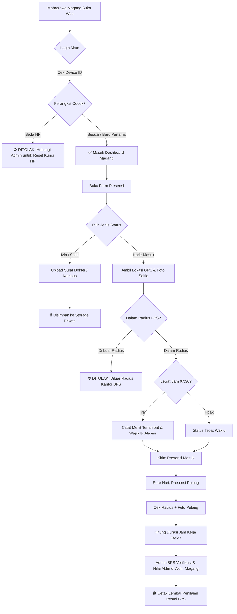

<div align="center">

  

  # 🏢 SIM-MAGANG BPS KARANGANYAR
  ### Sistem Informasi Presensi Geofencing, Anti-Kecurangan & Evaluasi Magang Berbasis Web

  <p align="center">
    <strong>Solusi presensi cerdas, aman, dan transparan untuk operasional Badan Pusat Statistik Kabupaten Karanganyar.</strong>
  </p>

  <p align="center">
    <a href="https://laravel.com"></a>
    <a href="https://php.net"></a>
    <a href="https://tailwindcss.com"></a>
    <a href="https://alpinejs.dev"></a>
    <a href="https://leafletjs.com"></a>
    <a href="https://mysql.com"></a>
    <a href="https://pestphp.com"></a>
  </p>

  <p align="center">
    <a href="#-fitur-unggulan">Fitur Unggulan</a> •
    <a href="#-alur-sistem">Alur Sistem</a> •
    <a href="#-antarmuka--fitur-keamanan">Fitur Keamanan</a> •
    <a href="#-rubrik-penilaian-magang">Rubrik Evaluasi</a> •
    <a href="#-panduan-instalasi">Instalasi</a> •
    <a href="#-pengujian-otomatis">Pengujian</a> •
    <a href="#-kontributor">Kontributor</a>
  </p>
</div>

---

## 📖 Ringkasan Proyek

**SIM-MAGANG BPS Karanganyar** adalah aplikasi web presensi dan manajemen peserta magang terpadu yang dirancang khusus untuk memenuhi standar integritas tinggi pada instansi pemerintah, khususnya **Badan Pusat Statistik (BPS) Kabupaten Karanganyar**.

Aplikasi ini mengatasi kendala klasik pada sistem presensi magang konvensional seperti **titip absen**, **manipulasi lokasi (Fake GPS / GPS Spoofing)**, **kebocoran dokumen surat dokter**, dan **kehilangan rekap jam kerja nyata**. Dilengkapi dengan modul evaluasi akhir resmi berstandar BPS untuk menghasilkan lembar penilaian siap cetak.

---

## 🌟 Fitur Unggulan

### 🛡️ 1. Anti-Kecurangan & Keamanan Tingkat Tinggi (*High-Security Suite*)
* 🔒 **Device Binding (1 Akun = 1 HP Terdaftar)**  
  Saat login pertama kali, *device fingerprint* (UUID tersimpan di peramban + User-Agent) otomatis dikunci ke akun peserta. Login dari HP atau laptop lain akan ditolak otomatis. Kunci perangkat hanya dapat di-reset oleh Admin BPS secara terotorisasi.
* 📍 **Geofencing GPS Radius Kantor (Formula Haversine)**  
  Peserta wajib berada dalam batas radius yang ditentukan (default: 50–100 meter) dari titik koordinat kantor BPS Karanganyar (`-7.5986877, 110.9490212`). Kalkulasi jarak divalidasi langsung di sisi backend server, bukan sekadar JavaScript client.
* 📸 **Mandatori Kamera Swafoto (Live Selfie In & Out)**  
  Wajib mengambil foto wajah saat presensi masuk dan pulang. Sistem mendukung kamera depan gawai dan validasi tipe berkas MIME terenkripsi.
* 📁 **Penyimpanan Dokumen Medis Privat (*Private File Storage*)**  
  Surat sakit dokter dan surat izin dispensasi kampus disimpan di `storage/app/private/` (tertutup dari akses publik). Akses dokumen diproteksi dengan otorisasi berbasis gate: **hanya Admin BPS atau mahasiswa pemilik surat yang berhak mengunduh/melihat dokumen**.

---

### ⏱️ 2. Presensi Masuk, Pulang & Deteksi Keterlambatan
* ⏰ **Presensi Pulang (Check-Out) & Durasi Kerja Nyata**  
  Peserta mencatatkan waktu pulang dengan validasi radius kantor dan foto kepulangan. Sistem otomatis menghitung durasi jam kerja harian secara akurat (contoh: *8 jam 15 menit*).
* ⚠️ **Deteksi Keterlambatan Otomatis & Izin Terlambat**  
  Presensi masuk secara dinamis dibandingkan dengan konfigurasi jam masuk kantor (contoh: `07:30 WIB`). Jika melewati batas waktu, sistem otomatis menandai status *Terlambat*, menghitung selisih menit, dan mewajibkan peserta mengisi form alasan keterlambatan.
* 📅 **Kalender Hari Libur & Akhir Pekan**  
  Otomatis mengenali hari Sabtu/Minggu dan hari libur nasional/cuti bersama sehingga peserta tidak terkena sanksi alpa otomatis pada hari libur resmi.

---

### 🎓 3. Evaluasi Akhir & Cetak Lembar Nilai Resmi BPS
* 📊 **5 Rubrik Penilaian Akademik Terbobot**:
  | No | Kriteria Penilaian | Bobot | Deskripsi Indikator |
  |:--:|---|:---:|---|
  | 1 | **Kedisiplinan & Ketepatan Waktu** | `25%` | Kepatuhan jam masuk, jam pulang, dan tata tertib instansi. |
  | 2 | **Tanggung Jawab & Integritas** | `25%` | Kesungguhan menyelesaikan tugas dan kejujuran kerja. |
  | 3 | **Inisiatif & Keaktifan** | `15%` | Proaktif dalam bertanya, berpendapat, dan mencari solusi. |
  | 4 | **Kerjasama Tim & Komunikasi** | `15%` | Koordinasi dengan pegawai BPS dan sesama mahasiswa magang. |
  | 5 | **Kualitas Hasil Pekerjaan** | `20%` | Kerapian, ketelitian olah data statistik, dan ketepatan output. |
* 🎚️ **Slider Nilai Interaktif & Kalkulasi Real-time**: Menggunakan Alpine.js untuk menghitung nilai akhir (0–100) dan penentuan predikat huruf secara otomatis (**A** Sangat Baik, **B** Baik, **C** Cukup, **D** Kurang, **E** Sangat Kurang).
* 🖨️ **Cetak Lembar Nilai Siap PDF**: Menghasilkan dokumen cetak resmi ber-Kop Surat Badan Pusat Statistik Kabupaten Karanganyar, matriks nilai, catatan evaluasi pembimbing, dan kolom tanda tangan resmi.

---

### 📋 4. Rekapitulasi & Verifikasi Admin
* ✅ **Persetujuan Presensi (*Single & Bulk Approve*)**: Admin dapat memverifikasi presensi harian, membandingkan foto masuk vs foto pulang, dan menyetujui presensi secara massal.
* 📈 **Ekspor Laporan Matriks**: Rekapitulasi bulanan dapat diekspor ke format **PDF Matriks Horizontal** dan **CSV/Excel** untuk arsip akademik universitas.

---

## 🔄 Alur Sistem (Architecture Workflow)



---

## 👥 Matriks Hak Akses Pengguna

| Hak Akses / Fitur | Administrator BPS | Peserta Magang |
|---|:---:|:---:|
| **Presensi Masuk & Pulang (Geofence + Selfie)** | ❌ | ✅ |
| **Pengajuan Izin / Sakit + Upload Surat** | ❌ | ✅ |
| **Lihat Riwayat & Status Keterlambatan Pribadi** | ❌ | ✅ |
| **Lihat Rincian Nilai & Predikat Akhir** | ❌ | ✅ |
| **Verifikasi / ACC Presensi Harian (Single & Bulk)** | ✅ | ❌ |
| **Reset Kunci Perangkat (Unbind Device Peserta)** | ✅ | ❌ |
| **Kelola Data Peserta, Asal Kampus & Durasi Magang** | ✅ | ❌ |
| **Input Nilai 5 Rubrik & Catatan Evaluasi Magang** | ✅ | ❌ |
| **Cetak Lembar Nilai Resmi Ber-Kop BPS** | ✅ | ❌ |
| **Ekspor Laporan Matriks Presensi (PDF & CSV)** | ✅ | ❌ |
| **Pengaturan Koordinat Kantor, Radius & Jam Kerja** | ✅ | ❌ |

---

## 💻 Tech Stack & Arsitektur

```
absensi_magang/
├── app/
│   ├── Http/Controllers/
│   │   ├── Admin/             # Controller Admin (Verifikasi, Rekap, Evaluasi, Intern, Setting)
│   │   ├── Intern/            # Controller Magang (Absen, Pulang, Riwayat, Evaluasi)
│   │   ├── AttachmentController.php  # Protected Private Document Downloader
│   │   └── AuthController.php        # Auth with Device Fingerprint Binding
│   ├── Models/
│   │   ├── Attendance.php     # Logic durasi kerja, keterlambatan, badge status
│   │   ├── InternEvaluation.php # Rumus bobot 5 rubrik & predikat
│   │   ├── User.php           # Relasi evaluasi & atribut kunci perangkat
│   │   └── Setting.php        # Konfigurasi koordinat kantor, radius, jam masuk
│   └── Services/
│       └── AttendanceService.php # Kalkulator Haversine & Geofencing
├── database/
│   ├── migrations/            # 11 Berkas skema database terintegrasi
│   └── seeders/               # Akun default admin & peserta magang contoh
├── resources/
│   └── views/                 # Blade Templates (Tailwind CSS, Alpine.js, Lucide Icons)
└── tests/
    └── Feature/AttendanceSystemTest.php # Pengujian Otomatis (15 Test Suites)
```

---

## 🚀 Panduan Instalasi Lokal

### 1. Prasyarat Sistem
- **PHP** `>= 8.2` (dengan ekstensi `pdo`, `mbstring`, `openssl`, `curl`, `fileinfo`)
- **Composer** `>= 2.0`
- **Node.js** `>= 18.x` & **NPM**
- **MySQL / MariaDB**

### 2. Kloning Repositori
```bash
git clone https://github.com/faizarfi/presensi-magang.git
cd presensi-magang
```

### 3. Pasang Dependensi
```bash
composer install
npm install
```

### 4. Konfigurasi Environment (`.env`)
Salin template konfigurasi dan generate application key:
```bash
cp .env.example .env
php artisan key:generate
```

Sesuaikan database pada `.env`:
```env
APP_NAME="Absensi Magang BPS Karanganyar"
APP_ENV=local
APP_URL=http://localhost:8000
APP_TIMEZONE=Asia/Jakarta

DB_CONNECTION=mysql
DB_HOST=127.0.0.1
DB_PORT=3306
DB_DATABASE=absensi
DB_USERNAME=root
DB_PASSWORD=
```

### 5. Migrasi & Pembuatan Akun Default
```bash
php artisan migrate --seed
php artisan storage:link
```

### 6. Kompilasi Aset & Jalankan Server
```bash
npm run build
php artisan serve
```

Aplikasi dapat langsung diakses di browser melalui URL: **`http://localhost:8000`**

---

## 🔑 Kredensial Pengujian Bawaan

| Peran | Email | Kata Sandi | Deskripsi |
|---|---|---|---|
| **Admin BPS** | `admin@bps.go.id` | `password` | Akses penuh verifikasi, penilaian, pengaturan kantor, dan reset HP |
| **Peserta Magang 1** | `budi@student.ac.id` | `password` | Mahasiswa Universitas Sebelas Maret (UNS) |
| **Peserta Magang 2** | `siti@student.ac.id` | `password` | Mahasiswi Universitas Muhammadiyah Surakarta (UMS) |

---

## 🧪 Pengujian Otomatis (Automated Testing)

Aplikasi telah dilengkapi pengujian otomatis *end-to-end* menggunakan PHPUnit & Pest untuk memastikan seluruh aturan bisnis dan keamanan berjalan tanpa cacat:

```bash
php artisan test
```

### 📋 Cakupan Pengujian:
```text
✓ haversine distance and office radius calculation
✓ holiday and weekend detection
✓ automatic absence evaluation cron
✓ role based access control (Admin vs Intern)
✓ admin single and bulk approve
✓ all redesigned views render successfully
✓ intern creation and duration management
✓ rekap pdf export contains matrix without daily logbook
✓ intern can upload medical and dispensation attachment securely
✓ intern and admin can change password securely
✓ checkout and work duration calculation
✓ device binding prevents titip absen and admin can reset device
✓ admin can evaluate intern, compute weighted score, and print sheet

Tests:    15 passed (109 assertions)
Duration: 2.59s
```

---

## 🛡️ Standar Keamanan & Perlindungan Privasi

* **CSRF Protection**: Seluruh request form terlindungi token CSRF Laravel.
* **SQL Injection & XSS Immunity**: Menggunakan PDO prepared statements bawaan Eloquent ORM dan sanitasi Blade engine.
* **Hashed Credentials**: Seluruh kata sandi di-hash menggunakan algoritma **Bcrypt** (12 rounds).
* **Strict Role Middleware**: Seluruh rute admin terisolasi oleh middleware otorisasi `role:admin`.
* **Zero Direct File Exposing**: Dokumen surat izin/sakit tidak dapat diakses langsung via link publik, melainkan melalui pipeline otorisasi `AttachmentController`.

---

## 🏛️ Instansi Penerima

**Badan Pusat Statistik (BPS) Kabupaten Karanganyar**  
Jl. Lawu No. 385B, Badran Asri, Cangakan, Kec. Karanganyar, Kabupaten Karanganyar, Jawa Tengah 57712  
🌐 Website Resmi: [karanganyarkab.bps.go.id](https://karanganyarkab.bps.go.id)

---

## 👨‍💻 Pengembang

Dikembangkan dengan dedikasi untuk efisiensi digitalisasi BPS Karanganyar oleh **Faiz Arfi P.** ([@faizarfi](https://github.com/faizarfi)).

<div align="center">
  <sub>Dibuat dengan ❤️ untuk kemajuan pelayanan statistik dan pembinaan generasi muda Indonesia.</sub>
</div>
